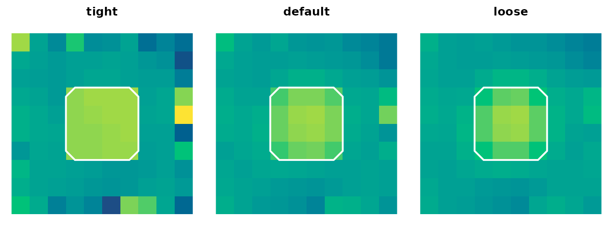

# Local Adaptive Inference with LISA

Voxelwise inference is hostile to small focal effects: each voxel pays
its own multiple-testing cost, and a true 2-voxel blob can sit just
under the voxelwise threshold even when its neighbours quietly agree
with it. Cluster and TFCE methods recover that signal by pooling over
space, but they pool the same way everywhere, smoothing local detail
away. **LISA** keeps the locality. It runs the same edge-preserving
bilateral filter on the observed statistic map *and on every matched
null draw*, then estimates voxelwise FDR in the filtered-statistic
space. Voxels that align with a coherent local neighbourhood get
amplified; isolated noise spikes get attenuated; the FDR target is
honoured because the null is filtered the same way.

This vignette teaches the full LISA pipeline on a tiny synthetic example
you can step through in seconds.

## First win

Start with a 3D volume that has a small planted blob. Build a null spec
from permuted maps, build a filter, call
[`lisa()`](https://bbuchsbaum.github.io/neurothresh/reference/lisa.md) —
the q-value map and rejection mask come back in a single
`neurothresh_result`.

``` r

ns <- null_from_maps(z, nulls)
filt <- lisa_bilateral(radius = 1, n_iter = 1, boundary = "mask_normalized")
fit <- lisa(stat_vol = ns$stat_vol, mask = ns$mask, null_spec = ns,
            filter = filt, backend = "reference",
            tail = "pos", q = 0.10)
fit
#> <neurothresh_result>
#>   method   : lisa 
#>   q        : 0.1 
#>   tail     : pos 
#>   threshold: 4.604 
#>   rejected : 72 / 1000 voxels (7.20%)
```


Mid-axial slice of the planted-blob example: input Z, filtered
statistic, q-value map, and the LISA rejection mask.

The blob lights up in the filtered map (smoother peak), survives at q ≤
0.10, and the rejection mask localises it without bleeding far outside
its true support.

## The mental model

LISA has four objects you compose:

| Object | Built by | Role |
|:---|:---|:---|
| `neurothresh_null_spec` | [`null_from_maps()`](https://bbuchsbaum.github.io/neurothresh/reference/null_from_maps.md), [`null_one_sample()`](https://bbuchsbaum.github.io/neurothresh/reference/null_one_sample.md), [`null_two_sample()`](https://bbuchsbaum.github.io/neurothresh/reference/null_two_sample.md), [`null_glm()`](https://bbuchsbaum.github.io/neurothresh/reference/null_glm.md), … | Bundles the observed map, mask, and a deterministic-by-index draw function |
| `neurothresh_lisa_filter` | [`lisa_bilateral()`](https://bbuchsbaum.github.io/neurothresh/reference/lisa_bilateral.md) | Specifies radius, range/space sigmas, boundary handling, iterations |
| inference call | `lisa(stat_vol, mask, null_spec, filter, ...)` | Filters the observed map and every null draw, then runs FDR in filtered space |
| `neurothresh_result` | returned by [`lisa()`](https://bbuchsbaum.github.io/neurothresh/reference/lisa.md) | Method-tagged object with `pvals` (q-values), `reject`, and `extras$filtered_stat` |

The pipeline is always the same shape: **build inputs → build a null
spec → build a filter → call
[`lisa()`](https://bbuchsbaum.github.io/neurothresh/reference/lisa.md) →
inspect the result.** The wrappers
[`lisa_onesample()`](https://bbuchsbaum.github.io/neurothresh/reference/lisa_onesample.md),
[`lisa_twosample()`](https://bbuchsbaum.github.io/neurothresh/reference/lisa_twosample.md),
and
[`lisa_glm()`](https://bbuchsbaum.github.io/neurothresh/reference/lisa_glm.md)
chain steps 1–3 for common designs.

## Tuning the bilateral filter

The filter has two scales:

- `sigma_space` controls how far in **physical neighbourhood** the
  filter averages — bigger σ pools across more voxels.
- `sigma_range` controls how much **statistic disagreement** is
  tolerated — bigger σ pools across more value differences (less
  edge-preserving).

`radius` caps the neighbourhood at ±r voxels. `n_iter > 1` re-applies
the filter, sharpening edges. `boundary = "mask_normalized"` re-weights
at the mask border so edge voxels are not dragged toward zero.

``` r

filters <- list(
  tight   = lisa_bilateral(radius = 1, sigma_space = 0.7, sigma_range = 1,
                            n_iter = 1, boundary = "mask_normalized"),
  default = lisa_bilateral(radius = 1, n_iter = 1, boundary = "mask_normalized"),
  loose   = lisa_bilateral(radius = 1, sigma_space = 1.5, sigma_range = 4,
                            n_iter = 1, boundary = "mask_normalized")
)
filtered <- lapply(filters, function(f) {
  fit_f <- lisa(stat_vol = ns$stat_vol, mask = ns$mask, null_spec = ns,
                filter = f, backend = "reference", tail = "pos", q = 0.10)
  as.numeric(lisa_filtered_stat(fit_f))
})
```



A **tight** filter behaves close to voxelwise inference: it preserves
edges but pools little. A **loose** filter behaves more like cluster
inference: the blob spreads into a soft halo. The default sits between
them. You usually want defaults; reach for tighter settings when peaks
are dense and edges matter, looser settings when effects are diffuse.

## From subject maps

When you have subject-level images, the
[`lisa_onesample()`](https://bbuchsbaum.github.io/neurothresh/reference/lisa_onesample.md)
wrapper builds the null spec for you using
[`null_one_sample()`](https://bbuchsbaum.github.io/neurothresh/reference/null_one_sample.md).
The same `tail`, `q`, `filter`, and `backend` arguments flow through.

``` r

imgs <- replicate(8, plant_blob(make_smooth(), amp = 2.5), simplify = FALSE)
one <- lisa_onesample(
  imgs,
  n_perm = 24,
  seed = 1,
  filter = lisa_bilateral(radius = 1, n_iter = 1,
                          boundary = "mask_normalized"),
  backend = "reference",
  tail = "pos",
  q = 0.20
)
one
#> <neurothresh_result>
#>   method   : lisa 
#>   q        : 0.2 
#>   tail     : pos 
#>   threshold: 1.166 
#>   rejected : 91 / 1000 voxels (9.10%)
```

Two-group designs use `lisa_twosample(imgs, group, ...)`. Anything more
involved — covariates, nuisance regressors, between-subject contrasts —
uses `lisa_glm(imgs, design, contrast, ...)` and is the recommended path
whenever the analysis is not strictly one- or two-sample.

## External statistic maps

Use
[`null_from_maps()`](https://bbuchsbaum.github.io/neurothresh/reference/null_from_maps.md)
when the observed map and the permuted null maps come from a different
pipeline (an MVPA searchlight, a cluster job, a permutation saved to
disk):

``` r

ns_ext <- null_from_maps(z, nulls)
fit_ext <- lisa(stat_vol = ns_ext$stat_vol, mask = ns_ext$mask,
                null_spec = ns_ext,
                filter = lisa_bilateral(radius = 1, n_iter = 1,
                                        boundary = "mask_normalized"),
                backend = "reference", tail = "pos", q = 0.10)
sum(fit_ext$reject)
#> [1] 72
```

The list of permuted maps must use the same observed-map dimensions;
LISA does not re-mask or re-canonicalise external inputs.

## A null spec is reusable

The same `null_spec` can drive both LISA and other neurothresh inference
methods, so you can compare local-adaptive FDR against, e.g.,
scale-space localised energy without re-permuting:

``` r

sse <- scale_space_energy(
  null_spec = ns,
  scales = scale_space(2, include_global = FALSE),
  statistics = list(signed_coherence(tail = "two")),
  n_perm = ns$n_perm
)
summary(sse)
#>   scale_index channel_index scale_type fwhm_mm              channel      min_p
#> 1           1             1   gaussian       2 signed_coherence_two 0.01639344
#> 2           2             1   identity       0 signed_coherence_two 0.01639344
#>   max_stat any_supported n_supported effective_basis
#> 1 7.440220          TRUE          77             125
#> 2 7.269869          TRUE          64            1000
```

This is the canonical neurothresh contract in action: build the null
once, spend it across whichever inference methods answer your scientific
question.

## Inspecting the result

`fit` is a standard `neurothresh_result`, so the same accessors work as
for every other inference method in the package. The LISA-specific bits
live under `extras`:

``` r

fit$threshold
#> [1] 4.603933
sum(fit$reject)
#> [1] 72
range(as.numeric(fit$pvals), finite = TRUE)
#> [1] 0.02678571 0.99928333
lambda <- lisa_filtered_stat(fit)
range(as.numeric(lambda), finite = TRUE)
#> [1] -7.873699 10.396897
names(fit$extras)
#> [1] "filtered_stat"    "fdr_curve"        "null_tail_counts"
```

`fit$pvals` is the voxelwise q-value volume, monotone in evidence by
default. `fit$reject` is the rejection mask at the supplied `q`.
`extras$filtered_stat` is the filtered observed map (the same shape as
`stat_vol`); use `lisa_filtered_stat(fit)` rather than reaching into
`extras` directly.

For diagnostics — sanity-checking the filter, plotting the filtered null
distribution at a voxel — pass `store_filtered_nulls = TRUE`. Only do
this on small runs; the full filtered-null matrix is
`n_perm × sum(mask)`.

## Backend notes

| Backend | When to use |
|:---|:---|
| `"reference"` (default in tests) | Mask-aware, slower; use for small volumes, debugging, or when boundary semantics matter |
| `"neuroim2"` | Adapts [`neuroim2::bilateral_filter()`](https://bbuchsbaum.github.io/neuroim2/reference/bilateral_filter.html); fastest path, but uses neuroim2’s boundary convention |
| `"adjoin_sparse"` | Reserved; not enabled because bilateral weights are statistic-dependent and must be rebuilt per draw |

Filter weights depend on each statistic map (the bilateral kernel uses
the voxel values themselves), so there is no shared weight matrix to
amortise across draws. The cost of LISA is dominated by `n_perm` filter
applications; plan accordingly.

## Where to go next

- [`?lisa_bilateral`](https://bbuchsbaum.github.io/neurothresh/reference/lisa_bilateral.md)
  — full filter argument reference
- [`?lisa`](https://bbuchsbaum.github.io/neurothresh/reference/lisa.md)
  — full inference signature
- [`vignette("scale-space-localized-energy")`](https://bbuchsbaum.github.io/neurothresh/articles/scale-space-localized-energy.md)
  — the multiscale companion to LISA
- [`vignette("neurothresh")`](https://bbuchsbaum.github.io/neurothresh/articles/neurothresh.md)
  — the canonical pipeline shared by every inference method in the
  package
